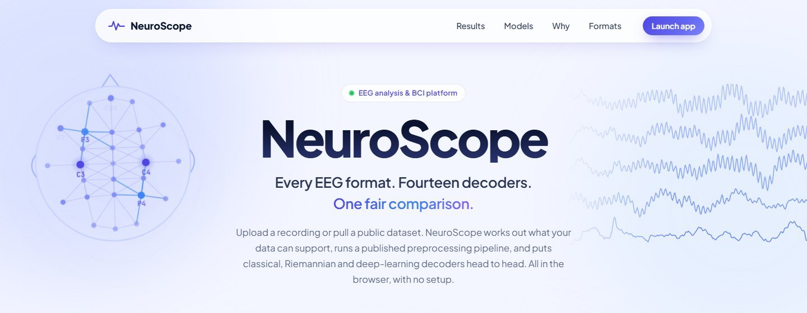
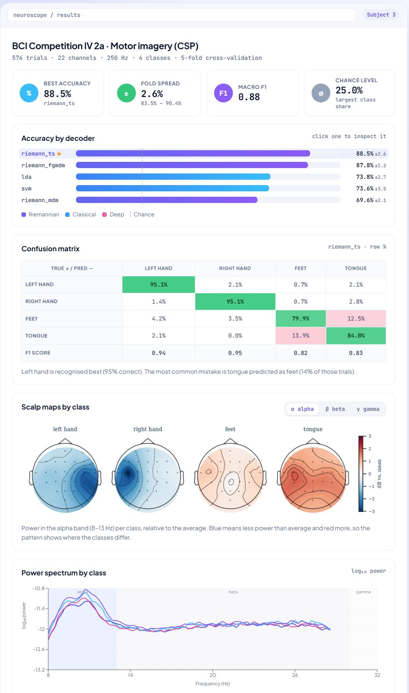
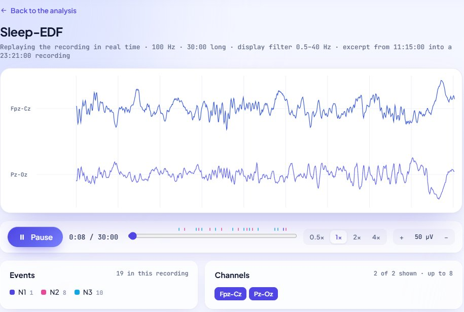

# NeuroScope

**An EEG analysis and brain–computer interface platform in the browser.** Load a recording or a
public dataset, and NeuroScope works out what the data can support, runs a preprocessing
pipeline taken from published methods, and compares 14 classical, Riemannian and deep-learning
decoders with cross-validation that can't leak test data. Or just watch a recording play back
as a live, scrolling EEG trace.

### ▶ [Try the online demo](https://nikhilt4.github.io/neuroscope/)



---

## Why I built it

I built two EEG brain–computer interfaces before this one: a drowsiness-detection headband and a
real-time motor-imagery BCI, both with custom PCBs and on-chip classification. Both times, the
hardware wasn't what slowed me down. Off the board, I kept losing weeks to the same three problems:

1. **Every dataset speaks a different format.** EDF, BDF, FIF, BIDS, MATLAB, each with its own
   loader and event conventions, before you see a single trial.
2. **Every project rebuilds the pipeline.** Filters, epoch windows, re-referencing and event
   codes, re-derived from a methods section every time.
3. **Quick comparisons quietly cheat.** Fit CSP or a scaler on all the data before
   cross-validating, and accuracy goes up for the wrong reason.

NeuroScope is the tool I wished I'd had. It also feeds my MSc research at Imperial College
London on compressing EEG decoders to run on microcontrollers. Deciding which decoders are worth
compressing starts with comparing them fairly.

## What you can do

- **Load almost any EEG data.** EDF / BDF / GDF, FIF (raw or already epoched), BIDS as a ZIP,
  or public datasets from MNE, MOABB and braindecode: BCI Competition IV 2a, PhysioNet motor
  imagery, Sleep-EDF, ERP CORE and more. BrainVision and CSV are in beta.
- **Let it read the data first.** A detector inspects channels, montage and event markers and
  offers only the analyses the data supports. Motor imagery needs C3 and C4; ERP needs events.
- **Pick an analysis mode.** Motor imagery (CSP spatial filters), spectral (band power), ERP
  (time-domain amplitudes in 50 ms bins) or basic signal statistics.
- **Start from published preprocessing.** Known datasets get presets taken from their papers;
  every value can be changed, and the UI shows which ones came from a preset.
- **Compare 14 decoders on one leaderboard**, all scored with the same stratified
  cross-validation.
- **Evaluate across people.** Within-subject (each person trained and tested on their own data,
  reported as mean ± spread, as BCI papers do) or cross-subject (leave one subject out: can it
  work on someone it has never seen?).
- **Read the results.** Accuracy and macro-F1 per decoder, fold spread, a confusion matrix with
  per-class F1, alpha/beta/gamma scalp maps per class, power spectra, and a "reproduce this
  run" export with every parameter. When classes are imbalanced, decoders are ranked by
  balanced accuracy instead, with the reason shown.
- **Play a recording back.** Scrolling multi-channel traces with event markers as they happen,
  0.5×–4× speed, gain, channel selection and seeking.

<p align="center">
  
</p>



## The decoders

| Family | Decoders | Notes |
|---|---|---|
| **Classical** | LDA, SVM, Random Forest, logistic regression, Extra Trees, gradient boosting, MLP, kNN, Naive Bayes | Run on CSP filters, band power, ERP amplitudes or signal statistics, depending on the mode |
| **Riemannian** | Tangent space, MDM, FgMDM, xDAWN + tangent space | Each trial's covariance matrix is a point on a curved manifold, classified there ([pyRiemann](https://pyriemann.readthedocs.io)) |
| **Deep learning** | EEGNet | Compact CNN (Lawhern et al. 2018), about 3,400 parameters, via [braindecode](https://braindecode.org) on the GPU |

**No leakage by construction.** CSP and feature scaling sit inside a scikit-learn `Pipeline`,
so every fold fits them on its own training trials only. A test checks that CSP is fitted on
exactly the training-fold trials. Predictions are out-of-fold for every trial, and if one
decoder fails the others still finish.

## Results

BCI Competition IV 2a (MOABB `BNCI2014_001`), 4-class motor imagery (left hand, right hand,
feet, tongue), chance 25%, 5-fold cross-validation, default settings:

| Decoder | Subject 1 | Subject 3 | All 9 subjects (within-subject) |
|---|---|---|---|
| Tangent space | 83.3% | 88.5% | 74.4% ± 12.9 |
| FgMDM | 79.7% | 87.8% | 72.1% ± 13.4 |
| CSP + LDA | 73.4% | 73.8% | 61.1% ± 12.5 |
| CSP + SVM | 74.1% | 73.6% | 61.1% ± 12.1 |
| MDM | 74.1% | 69.6% | 58.8% ± 12.5 |

The ordering is what the literature predicts at this sample size: Riemannian methods lead and
CSP methods trail. People differ a lot, though. Tangent space ranges from 49.5% (subject 5) to
88.5% (subject 3) with the same code, which is why every result in NeuroScope names the
subject it came from.

## The online demo

The [demo](https://nikhilt4.github.io/neuroscope/) is a static build with no server. Every
result in it was recorded from the real backend: BCI Competition IV 2a subject 3 in all four
modes, both multi-subject evaluations over all 9 subjects, Sleep-EDF subject 1, and a 30-minute
Sleep-EDF playback excerpt that streams in your browser.

You can walk the whole wizard, pick modes and decoders, and see real results. Changing
preprocessing or hyperparameters won't change them, and uploads are off; the demo says so at
each step. For everything else, run it locally.

## Run it locally

Needs Python 3.12 and Node 18+ (Vite 5's minimum). A CUDA GPU speeds up EEGNet but isn't required.

```bash
# backend (from the repo root)
python -m venv venv
source venv/bin/activate          # Windows: .\venv\Scripts\Activate.ps1
pip install -r requirements.txt
uvicorn backend.main:app --reload # http://127.0.0.1:8000, API docs at /docs

# frontend (second terminal)
cd frontend
npm install
npm run dev                       # http://localhost:5173
```

Public datasets download on first use into MNE's data folder; later loads come from the cache.

```bash
python -m pytest                  # fast tests
python -m pytest -m slow -s       # real-data regression checks (downloads datasets)

cd frontend
npm run dev:demo                  # the online demo, locally
npm run build:demo                # → frontend/dist-demo
python -m backend.demo.record_demo  # re-record the demo's data (backend must be running)
```

## How it fits together

```
React + Vite wizard ── api.js ──► FastAPI
                                   ├─ fetchers/   MNE · MOABB · braindecode · uploads
                                   ├─ core/       detector · presets · pipeline · features
                                   │              classifiers · multi-subject · playback
                                   └─ jobs.py     each fetch/analysis in its own process
```

- **Long work runs in its own process.** Downloads and training run as background jobs in
  separate processes that can be cancelled and time out. An early version ran them inside the
  web request, where one stalled download could lock up a server worker for good.
- **Sessions are stateless.** A session is a small JSON record of where the data came from.
  Each analysis rebuilds the data from it, so sessions survive server restarts.
- **Playback streams over Server-Sent Events**, 25 frames a second, paced to the clock, and
  drawn on a canvas.

## What's next

- **More decoders:** filter-bank CSP, ShallowFBCSPNet / Deep4Net, and compact, embedded-friendly
  CNNs such as EEG-TCNet, which tie into the microcontroller work.
- **Cross-subject alignment:** re-centering each person's covariance matrices (Zanini et al.
  2018) to close the gap when testing on someone new.
- **Live decoding** on top of playback: the classifier labels the recording as it scrolls past.
- **SSVEP decoders** (CCA / filter-bank CCA), playback for uploaded files, and a hosted
  backend.

## Built with

[MNE-Python](https://mne.tools) · [MOABB](https://moabb.neurotechx.com) ·
[braindecode](https://braindecode.org) · [pyRiemann](https://pyriemann.readthedocs.io) ·
[scikit-learn](https://scikit-learn.org) · [PyTorch](https://pytorch.org) ·
[FastAPI](https://fastapi.tiangolo.com) · [React](https://react.dev) · [Vite](https://vite.dev) ·
[Recharts](https://recharts.org)

---

Built by **Nikhil Talwalkar** (MSc Advanced Computing, Imperial College London).
[LinkedIn](https://www.linkedin.com/in/nikhil-talwalkar)
